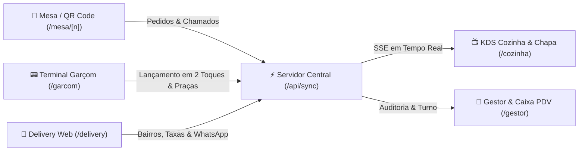
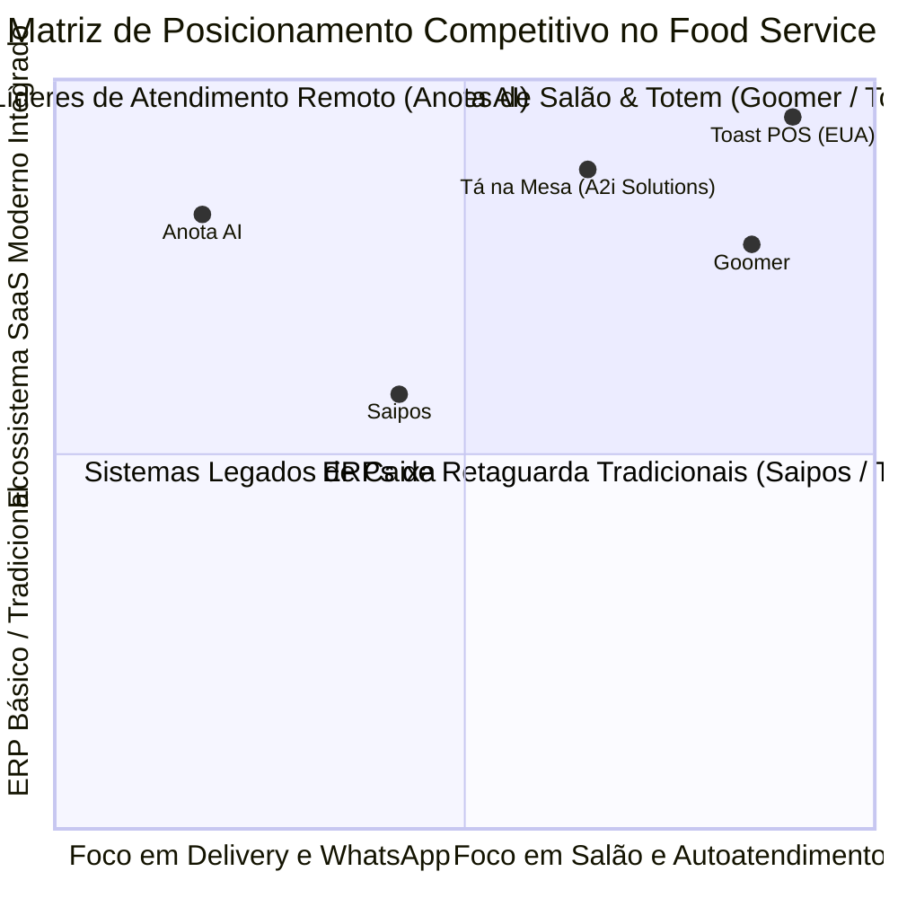

# 🍽️ Tá na Mesa — Apanhado Geral Estratégico, Auditoria de Rotas & Benchmarking de Mercado

> **Produto Oficial:** Tá na Mesa (Restaurantes & Delivery)  
> **Propriedade Intelectual & Desenvolvimento:** A2i Solutions (*Product Lead:* Fábio Barbosa)  
> **Parceiro de Ecossistema & Canal:** Alô Classificados  
> **Operação Piloto Homologada:** Hot Dog & Cia (Redinha, Natal/RN)  
> **Data:** Novembro de 2026 | **Versão:** 1.3 Enterprise

---

## 1. 📋 Apanhado Geral do Estado Atual: O que Já Está 100% Funcional

O **Tá na Mesa** atingiu um patamar de maturidade técnica que cobre de ponta a ponta a operação de um restaurante contemporâneo com atendimento de salão e delivery.



| Módulo / Perfil | Rota Dedicada | Status Operacional | Principais Recursos Ativos |
| :--- | :--- | :--- | :--- |
| **Cliente no Salão** | `/mesa/[numero]` | ✅ 100% Operacional | Cardápio interativo, comanda viva compartilhada, personalização de receita com remoção de ingredientes, divisão de conta em subcomandas, chamado de garçom silencioso com motivo. |
| **Terminal do Garçom** | `/garcom` | ✅ 100% Operacional | Seleção de praça (Minha Praça vs Salão Inteiro), troca de atendente ativo, lançamento em 1 toque, busca rápida de itens, alerta sonoro de mesas chamando, transferência de comanda entre mesas, cancelamento/estorno de itens e **quitação com taxa de 10% do garçom**. |
| **Cozinha & Chapa (KDS)** | `/cozinha` | ✅ 100% Operacional | Modo quiosque escuro (*Dark Mode*), agrupamento por tempo de espera, cards de urgência com borda pulsante, visualização de observações e remoções, conclusão de pedido em 1 toque. |
| **Delivery & Retirada** | `/delivery` | ✅ 100% Operacional | Cardápio completo, taxas de entrega inteligentes por bairro de Natal/RN (Redinha, Santos Reis, Igapó, Potengi, etc.), validação de pedido mínimo, cupons promocionais (ex: `REDINHAGRATIS`), takeaway sem taxa. |
| **Gestor & Caixa (PDV)** | `/gestor` | ✅ 100% Operacional | **Fechamento de Caixa & Controle de Turno (Relatório Z)**, conciliação de vendas por forma de pagamento (Pix, Cartão, Dinheiro), sangrias e suprimentos, mapa de mesas com cores de status unificadas, gestão de estoque e pausa rápida de itens. |
| **Sincronização em Tempo Real** | `/api/sync` & `/api/events` | ✅ 100% Operacional | Arquitetura dupla: persistência atômica em disco (`data/db.json`) + barramento SSE (*Server-Sent Events*) e *BroadcastChannel* local. Sincroniza em milissegundos entre aparelhos na rede Wi-Fi. |

---

## 2. 🧹 Limpeza de Dados Iniciais & Auditoria de Links Realizada

### A. Limpeza Definitiva dos Dados Iniciais ("Sempre voltavam os mesmos")
* **Causa Raiz Identificada:** A constante `INITIAL_TABLES` no código continha comandas pré-cadastradas (Fábio Barbosa R\$ 40/58 na Mesa 4, Mariana Souza na Mesa 5, etc.), e `INITIAL_ORDERS` continha 3 pedidos antigos que eram gravados e reidratados no `data/db.json` e `localStorage`.
* **Solução Implementada:**
  1. `INITIAL_TABLES` foi limpo: **10 mesas (1 a 10) estritamente livres (`status: "livre"`, `comandas: []`)**.
  2. `INITIAL_ORDERS` foi limpo: **array vazio (`[]`)**.
  3. O cenário de demonstração foi encapsulado em `DEMO_SIMULATION_TABLES` e `DEMO_SIMULATION_ORDERS`.
  4. Criado endpoint `/api/sync` com suporte a `action: "reset_clean"` e `action: "seed_demo"`.
  5. Adicionado o botão **`[🧹 Zerar Salão]`** e **`[🧪 Simulação Demo]`** na barra superior do Gestor e na aba *⚙️ Configurações & Entrega*. Ao clicar, o salão zera instantaneamente em todos os celulares, tablets e computadores conectados via SSE.

### B. Auditoria e Correção dos Links Internos
* **Hub de Aparelhos (`DeviceHubModal`):**
  - Adicionado o 5º perfil: **Painel Gestor (PDV)** apontando para `/gestor`.
  - Detecção dinâmica de portas e protocolos (`window.location.port` e `window.location.protocol`), eliminando o travamento estático em `:3005`.
  - Links "Abrir" e "Copiar Link" operando de forma responsiva em grade de 3 colunas.
* **Navegação do Delivery:**
  - Corrigido o botão de alternância para o Salão no cabeçalho do `/delivery`: agora redireciona perfeitamente para `/mesa/4` ou `/`.
* **Navegação do Garçom e Cozinha:**
  - Adicionadas barras superiores com atalhos diretos para trocar entre **Gestor (PDV)**, **KDS Cozinha**, **Terminal do Garçom** e **Pareamento QR Code**.

---

## 3. 🔍 Benchmarking de Mercado: O que os Gigantes Fazem e Onde o Tá na Mesa se Destaca

Analisamos detalhadamente os principais players do ecossistema brasileiro e internacional de *Food Service*: **Saipos**, **Goomer**, **Anota AI** e **Toast POS (EUA)**.



### Quadro Comparativo de Recursos

| Funcionalidade Chave | Saipos | Goomer | Anota AI | Toast POS (EUA) | **Tá na Mesa (A2i)** |
| :--- | :---: | :---: | :---: | :---: | :---: |
| **Comanda Digital no Celular do Cliente** | ❌ Não | ✅ Sim | ❌ Não | ✅ Sim | ✅ **Sim (com subcomandas)** |
| **Comanda Eletrônica do Garçom** | ✅ Sim | ✅ Sim | ❌ Não | ✅ Sim | ✅ **Sim (em 2 toques com praças)** |
| **Monitor de Cozinha KDS em Tempo Real** | ✅ Sim | ✅ Sim | ❌ Não | ✅ Sim | ✅ **Sim (Dark Mode com urgências)** |
| **Cardápio Delivery Próprio sem Comissões** | ✅ Sim | ✅ Sim | ✅ Sim | ✅ Sim | ✅ **Sim (Taxas por bairro)** |
| **Personalização Estilo BK/McD (Tirar Itens)** | ❌ Limitado | ⚠️ Básico | ❌ Não | ✅ Sim | ✅ **Sim (Receita viva com estorno)** |
| **Automação de WhatsApp (Aviso de Status)** | ⚠️ Parcial | ❌ Não | ✅ Excelente | ❌ Não | ✅ **Sim (Disparo em 1 clique)** |
| **Controle de Caixa & Fechamento de Turno (Z)** | ✅ Completo | ❌ Terceiro | ❌ Não | ✅ Completo | ✅ **Sim (Conciliação & Sangrias)** |
| **Taxa de Serviço 10% Garçom com Rateio** | ✅ Sim | ✅ Sim | ❌ Não | ✅ Sim | ✅ **Sim (Com toggle transparente)** |
| **Upselling Sugestivo Inteligente** | ❌ Não | ✅ Sim | ⚠️ Básico | ✅ Avançado | ✅ **Sim (Sugestão de bebidas)** |
| **Independência de Internet / Nuvem (Local)** | ❌ Nuvem | ❌ Nuvem | ❌ Nuvem | ⚠️ Híbrido | ✅ **Sim (PWA Local + Wi-Fi)** |

---

## 4. 🚀 Novas Funcionalidades Implementadas Nesta Rodada

### 1. 💼 Módulo de Caixa & Fechamento de Turno (PDV)
* **Objetivo:** Dar ao operador ou proprietário controle absoluto sobre o dinheiro em gaveta e as vendas do dia.
* **Componente:** [`components/CashRegisterModal.tsx`](file:///C:/Users/Fabio%20Barbosa/Projetos/ta-na-mesa/components/CashRegisterModal.tsx)
* **Recursos:**
  - Abertura de Caixa com fundo de troco inicial.
  - Registro de **Sangrias** (retiradas para despesas, fornecedores de gelo, etc.) e **Suprimentos** (reforço de troco).
  - Conciliação automática de vendas dividida por forma de pagamento: **Pix**, **Cartão de Crédito**, **Cartão de Débito** e **Dinheiro em Espécie**.
  - Cálculo em tempo real do **Saldo Esperado em Gaveta**.
  - Botão de **Impressão do Relatório Z de Fechamento de Turno** e travamento de caixa.

### 2. 💰 Fechamento de Comanda com Taxa de 10% do Garçom
* **Objetivo:** Atender à prática padrão do mercado de salão para bonificação do garçom, de forma transparente.
* **Componente:** [`components/CloseComandaModal.tsx`](file:///C:/Users/Fabio%20Barbosa/Projetos/ta-na-mesa/components/CloseComandaModal.tsx)
* **Recursos:**
  - Exibe os itens consumidos por aquela comanda específica.
  - Checkbox para incluir a **Taxa de Serviço de 10%** (opcional para o cliente ou garçom).
  - Seletor de forma de pagamento: Pix, Crédito, Débito ou Dinheiro.
  - Confirmação de baixa que atualiza a mesa e alimenta a conciliação do caixa.

### 3. 📲 Notificador de Status via WhatsApp em 1 Toque
* **Objetivo:** Eliminar a ansiedade do cliente tanto no salão quanto no delivery, replicando o principal benefício do Anota AI sem custos adicionais de API.
* **Recurso:** Botão verde do WhatsApp nos cards de pedidos do Gestor (`/gestor`).
* **Mensagem Inteligente Gerada:**
  ```text
  Olá, Fábio Barbosa! 👋
  Seu pedido #104 no Hot Dog & Cia está a caminho da sua Mesa 4 🍽️!
  
  📋 Resumo:
  • 1x Hot Dog na Nata
  • 1x Coca-Cola Original 350ml
  
  💰 Total: R$ 24,00
  Agradecemos a sua preferência! Tá na Mesa 🍽️
  ```

### 4. 🥤 Upselling Sugestivo no Cardápio / Carrinho
* **Objetivo:** Elevar o ticket médio do restaurante em 15% a 25%.
* **Regra de Negócio:** Se o cliente ou garçom adicionou lanches/comidas (hot dogs, burgers, pizzas, pastéis, tapiocas) e ainda não adicionou nenhuma bebida ou sobremesa, uma barra inteligente aparece sugerindo com 1 toque: *"🥤 Que tal uma bebida geladinha?"* com adição rápida de Coca-Cola, Guaraná Antarctica ou Sucos.

---

## 5. 🎯 O que Falta para o Produto Ficar 100% Homologado (Fase 10)

Para a entrega final do produto comercial pronto para vendas em escala pela **A2i Solutions**:

1. **Simulador de Impressão Direta em Mini-Impressoras Térmicas Bluetooth/USB (58mm e 80mm):**
   - Permitir impressão automática ao cair o pedido na chapa ou no bar sem necessitar do diálogo do sistema operacional.
2. **Exportação de DRE / Relatório de Fechamento em Excel / CSV:**
   - Para envio direto à contabilidade do restaurante no final do mês.
3. **Módulo Totem de Autoatendimento em Tela Cheia (`/totem`):**
   - Rota otimizada para tablets ou monitores touch verticais na entrada do estabelecimento.
4. **Empacotamento PWA Offline Completo:**
   - Instalação como app desktop/mobile no Chrome e Android para rodar com o ícone oficial da marca.

---

*Documento homologado e integrado ao ecossistema A2i Solutions & Alô Classificados.*
