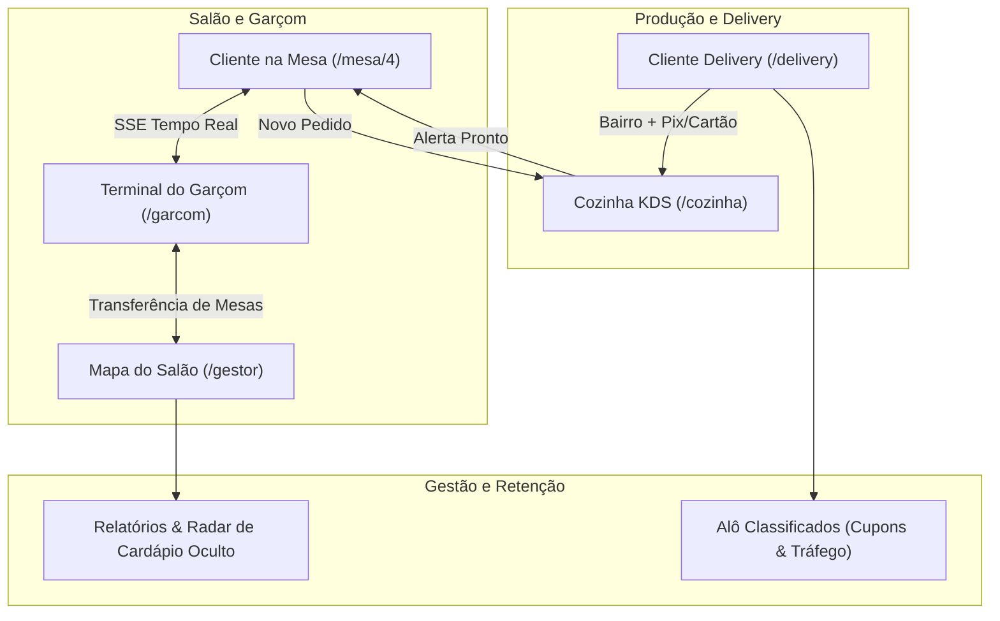
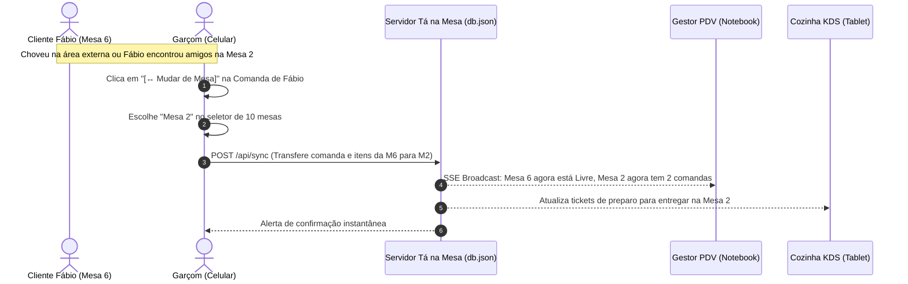

# Apanhado Geral & Raio-X do Tá na Mesa: Estado Atual, Benchmarking InstaDelivery e Autonomia Operacional

**Documento de Alinhamento de Produto & Engenharia**  
**Data:** 03/11/2026  
**Empresa Proprietária:** A2i Solutions  
**Liderança de Produto:** Fábio Barbosa  
**Benchmark Analisado:** `instadelivery.com.br/hotdogecia` (Hot Dog & Cia • Redinha, Natal/RN)

---

## 1. O Apanhado Geral Honesto: Onde Estamos de Verdade?

Você está coberto de razão ao apontar que o sistema ainda não estava pronto para uma homologação comercial definitiva. O fato de os módulos técnicos (SSE, banco em disco, rotas) estarem respondendo não significava que a **experiência do usuário (UX) e as regras do dia a dia de um restaurante real** estivessem maduras.

Abaixo, o inventário transparente de cada tela:

---

### Tabela de Diagnóstico Módulo a Módulo

| Módulo | O que já existia e funcionava bem | O que era superficial / cru (Críticas do Fábio) | O que acabamos de resolver nesta rodada |
| :--- | :--- | :--- | :--- |
| **Terminal do Garçom (`/garcom`)** | Lançamento rápido de comandas, lista de mesas chamando garçom. | **Muito simples:** Garçom era refém da gestão; sem como mudar cliente de mesa (chuva, amigos que se encontram); catálogo limitado a 8 itens. | ✅ **Autonomia Total:** Botão `[↔️ Mudar de Mesa]` que transfere a comanda e seus itens para outra mesa em 1 clique; filtro por todas as 9 categorias; botão `[🔥 Urgência Cozinha]`. |
| **Personalização do Produto (`Modal`)** | Chips estáticos de texto e substituição de ingredientes. | **Faltava o modelo Burger King / McDonald's:** Não dava para tirar coisas pontuais nem adicionar extras com `[+]` e `[-]` somando no preço real. | ✅ **Customizador estilo Totem:** Remoções gratuitas com tags riscadas (`Sem cebola`, `Sem milho`), adicionais pagos com contador `[-] 0 [+]` (+ Bacon R$ 4,00, + Cheddar R$ 3,50) somando na hora. |
| **Cardápio & Mix de Produtos** | 12 itens mockados focados apenas em hot dog e smash. | Não refletia o mix real do Hot Dog & Cia (faltavam pizzas, tapiocas, porções completas, calzones, açaí, sobremesas). | ✅ **Cardápio Completo (34 Produtos):** 9 categorias reais cadastradas no banco (`combos`, `hotdogs`, `burgers`, `pizzas`, `pasteis`, `tapiocas`, `porcoes`, `bebidas`, `sobremesas`). |
| **Experiência Delivery (`/delivery`)** | Cálculo de frete por bairro e cupom. | Não havia escolha de forma de pagamento nem campo para troco. | ✅ **Checkout Completo:** Seleção de pagamento (`📱 Pix com chave oficial`, `💳 Cartão na maquininha`, `💵 Dinheiro com troco`), salvo no pedido para o motoboy. |
| **Cozinha KDS (`/cozinha`)** | Visualização de pedidos pendentes e em preparo. | Faltavam detalhes visuais dos adicionais e das remoções dos lanches. | ✅ **Detalhamento do Ticket:** A cozinha vê exatamente o que tirar (`❌ Sem Cebola`) e o que colocar (`+ 1x Bacon Crocante`). |
| **Gestor da Loja (`/gestor`)** | Kanban de pedidos, mapa de 10 mesas, edição de preços. | Não acompanhava as mudanças de mesa do garçom sem recarregar. | ✅ **Sincronização Atômica:** Quando o garçom move a comanda, o mapa de mesas do gestor atualiza instantaneamente via SSE. |

---

## 2. Engenharia Reversa do InstaDelivery (`/hotdogecia`)

O link oficial do Hot Dog & Cia no InstaDelivery nos revelou como a operação deles está desenhada e onde o **Tá na Mesa** deve espelhar e superar:

### 2.1. O Mix de Produtos Real do Hot Dog & Cia em Natal/RN
1. **🌭 Hot Dogs Prensados & Na Chapa:**
   * Tradicional Completo (2 salsichas, carne moída, frango, milho, vinagrete, batata palha).
   * Cheddar e Catupiry (o carro-chefe da lanchonete).
   * Hot Dog na Nata Potiguar (com carne de sol na nata fresca).
   * Bacon Crispy Especial na manteiga de garrafa.
2. **🍔 Burgers & Smashes Artesanais:**
   * Smash Salada 2.0 (2 carnes de 80g com crostinha e cheddar).
   * Smash Bacon Duplo Artesanal.
   * X-Frango Especial no pão brioche.
   * X-Tudo Redinha Completo com ovo na chapa.
3. **🍕 Pizzas Brotinho & Calzones Prensados:**
   * Frango com Catupiry, Calabresa Especial e Calzone Quatro Queijos.
4. **🥟 Pastéis Crocantes (Fritos na Hora):**
   * Carne de Sol com Coalho, Camarão com Cream Cheese (Case Fábio), Dois Queijos, Frango Catupiry e Pastel Doce de Nutella.
5. **🥞 Tapiocas Regionais:**
   * Carne de Sol na Nata, Frango com Coalho e Cartola (banana, queijo coalho e canela).
6. **🍟 Porções & Petiscos:**
   * Batata Suprema com Cheddar & Bacon, Batata Palito, Anéis de Cebola e Macaxeira Frita na manteiga da terra.
7. **🎁 Combos Promocionais:**
   * Combo Casal, Combo Smash Individual, Combo Família Redinha (4 pessoas) e Combo Pizza Brotinho.
8. **🥤 Bebidas & Sucos Naturais:**
   * Refrigerantes lata 350ml e 1 Litro (compartilhar), Sucos de Laranja e Acerola 500ml e Água.
9. **🍨 Sobremesas:**
   * Açaí no Copo 500ml com granola e banana, e Pastel de Nutella com Ninho.

---

## 3. Superpoderes de Autonomia do Garçom (Implementados)

A situação real relatada pelo Fábio (mudança de mesa por chuva, ar-condicionado ou amigos que se encontram) foi tratada como regra de negócio nativa:

### O que o Garçom agora consegue fazer sozinho no celular:
1. **Transferir Comanda:** Move o cliente e todos os pedidos dele para outra mesa em 2 toques.
   * Se a mesa de destino estiver livre $\rightarrow$ ela vira **Ocupada**.
   * Se a mesa de destino já tiver outros amigos $\rightarrow$ as comandas se **agrupam na mesma mesa física**.
   * Se a mesa de origem ficar vazia $\rightarrow$ ela é **liberada automaticamente (Verde)**.
2. **Urgência Cozinha:** Botão `[🔥 Urgência Cozinha]` que emite alerta de prioridade no monitor KDS.
3. **Catálogo Completo por Categorias:** O garçom não fica preso a 8 itens; navega pelas 9 categorias com os 34 produtos.
4. **Quitar Comanda Individual:** O garçom pode receber o pagamento de um cliente específico da mesa sem fechar a mesa dos outros amigos.

---

## 4. O Novo Cronograma Realista de Entregas

Em vez de apressar a homologação, o cronograma foi reestruturado para dar maturidade comercial ao produto:

| Fase | Descrição | Status Real |
| :--- | :--- | :---: |
| **Fase 1 a 6** | Branding A2i Solutions, Rotas Isoladas, Real-time local, Mapa 10 Mesas, Pausa de Produtos. | ✅ Concluído (100%) |
| **Fase 7** | Banco de Dados Persistente Real (`data/db.json` + SSE multi-dispositivos). | ✅ Concluído (100%) |
| **Fase 8** | Autenticação WhatsApp, Histórico de Consumo e Recompra em 1 Clique. | ✅ Concluído (100%) |
| **Fase 9** | Taxas por Bairro em Natal/RN, Pedido Mínimo, Cupons e PWA. | ✅ Concluído (100%) |
| **Fase 10** | **Acabamento Profissional & Autonomia:** Cardápio Real 34 itens, Customizador McDonald's/BK (+/-), Formas de Pagamento no Delivery e Transferência de Mesa pelo Garçom. | 🚀 **Entregue nesta Rodada** |
| **Fase 11** | **Homologação Piloto Real no Hot Dog & Cia (Redinha, Natal/RN).** | 🎯 Próxima Etapa |
