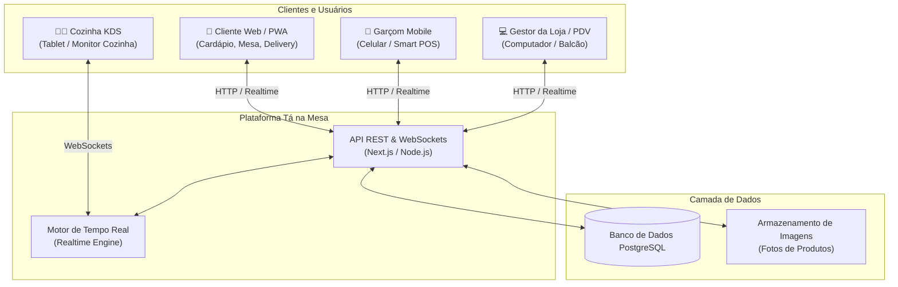
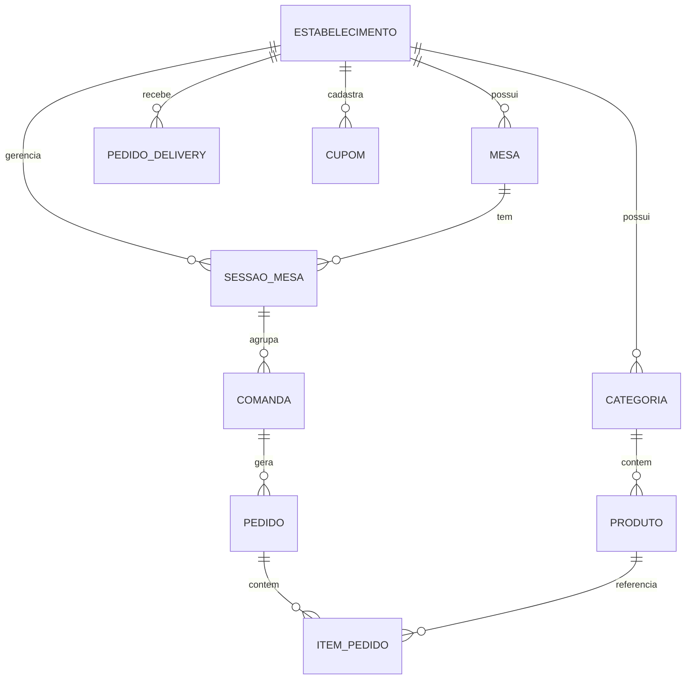

# Especificação Técnica & Arquitetura de Dados: Tá na Mesa

**Documento de Arquitetura de Software e Engenharia de Dados**  
**Data:** 03/11/2026  
**Projeto:** Tá na Mesa (A2i Solutions)  
**Módulo:** 4. Infraestrutura Tecnológica, Banco de Dados e Tempo Real

---

## 1. Visão Geral da Arquitetura

O **Tá na Mesa** é projetado como uma plataforma web moderna, rápida e responsiva, dividida em três frentes de acesso conectadas a um único núcleo de dados em tempo real:

---

## 2. Pilha de Tecnologias Recomendada (*Tech Stack*)

Para garantir velocidade máxima no celular do cliente e sincronização instantânea entre salão e cozinha:

1. **Frontend (Telas do Usuário e Painel):**
   * **Next.js & React:** Tecnologia líder de mercado que permite carregamento ultra-rápido do cardápio sem travamentos.
   * **Tailwind CSS:** Para interfaces visuais leves, modernas e totalmente adaptáveis a celulares e computadores.
   * **PWA (*Progressive Web App*, ou Aplicativo Web Progressivo):** Permite que o cliente use direto pelo navegador móvel ou "instale" como app com 1 clique.
2. **Backend & Comunicação em Tempo Real:**
   * **Supabase / PostgreSQL com WebSockets (*Canais de Comunicação Instantânea*):** O banco de dados envia atualizações automáticas para todas as telas no mesmo milissegundo em que um status muda.
   * **Web Audio API (*Tecnologia de Áudio no Navegador*):** Para disparar o alerta sonoro contínuo do Gestor de Pedidos sem precisar de programas instalados no Windows.
3. **Autenticação:**
   * Integração com o mesmo padrão do **Alô Classificados** (Login rápido por WhatsApp e Google).

---

## 3. Modelo de Banco de Dados Relacional (Entidades Principais)

O coração do sistema é estruturado para permitir que uma mesa física tenha múltiplas comandas independentes sem conflito.

### 3.1. Tabela `estabelecimentos` (Restaurantes e Lanchonetes)
* `id` (Identificador único)
* `nome` (Ex: "Hot Dog & Cia")
* `slug` (URL única, ex: "hotdogecia")
* `telefone_whatsapp`
* `chave_pix` (Para recebimento direto sem intermediação)
* `status_loja` (Aberta ou Fechada)
* `taxa_servico_ativa` (Sim/Não para os 10% opcionais)

### 3.2. Tabela `mesas` (Mesas Físicas do Salão)
* `id`
* `estabelecimento_id`
* `numero_mesa` (Ex: 04)
* `status_atual` (Livre, Ocupada, Chamando Garçom, Pedindo Conta)
* `qr_code_token` (Código de segurança para leitura)

### 3.3. Tabela `sessoes_mesa` (Ciclo de Atendimento da Mesa)
* `id`
* `mesa_id`
* `aberta_em` (Horário de início da ocupação)
* `fechada_em` (Horário da baixa e liberação)
* `status` (Ativa ou Encerrada)

### 3.4. Tabela `comandas` (Subcomandas da Mesa - O Pulo do Gato)
* `id`
* `sessao_mesa_id`
* `nome_responsavel` (Ex: "Fábio", "Cunhada", "Filho")
* `cliente_usuario_id` (Opcional - preenchido quando o cliente vincula seu celular)
* `status` (Aberta, Aguardando Pagamento, Paga)
* `total_comanda` (Valor acumulado)

### 3.5. Tabela `pedidos` (Envio para Produção)
* `id`
* `comanda_id` (Se for pedido de mesa)
* `delivery_id` (Se for pedido de delivery/retirada)
* `status_producao` (Pendente, Aceito/Em Preparo, Pronto/Expedido, Entregue, Cancelado)
* `horario_envio`
* `horario_pronto`

### 3.6. Tabela `itens_pedido` (Itens Individuais)
* `id`
* `pedido_id`
* `produto_id`
* `quantidade`
* `preco_unitario`
* `adicionais_escolhidos` (Texto/JSON com opcionais, ex: "Bacon extra, Farofa")
* `observacoes` (Ex: "Ponto bem passado, sem cebola")

### 3.7. Tabela `pedidos_delivery` (Vendas em Domicílio ou Retirada)
* `id`
* `estabelecimento_id`
* `nome_cliente`
* `whatsapp_cliente`
* `tipo` (Delivery ou Retirada)
* `endereco_entrega` (Rua, número, bairro, complemento)
* `taxa_entrega` (Valor calculado da entrega)
* `cupom_id` (Cupom aplicado, se houver)
* `forma_pagamento` (Dinheiro, Cartão na maquininha, Pix direto)
* `troco_para` (Se pagamento for em dinheiro)

### 3.8. Tabela `cupons` (Campanhas Promocionais e Parcerias)
* `id`
* `estabelecimento_id`
* `codigo` (Ex: "REDINHAGRATIS", "FRETEALO")
* `tipo_desconto` (Frete Grátis, Valor em Reais ou Porcentagem)
* `valor_desconto`
* `bairros_permitidos` (Lista de bairros com direito ao benefício)
* `valor_minimo_pedido` (Ex: R$ 30,00)
* `ativo` (Sim/Não)

---

## 4. O Mecanismo de Sincronização em Tempo Real (WebSockets)

Para que a experiência seja instantânea e sem atrasos:

1. **Quando o Garçom ou o Cliente lança um item na mesa:**
   * O banco registra o `pedido` e os `itens_pedido`.
   * Um evento `NOVO_PEDIDO_MESA` é disparado via WebSocket.
   * A tela da **Cozinha (KDS)** emite um bipe e exibe o cartão na coluna de preparo.
   * O **Painel do Gestor** atualiza o valor da mesa.
   * A **tela do celular do cliente** atualiza a comanda instantaneamente.

2. **Quando a Cozinha clica em [PRONTO]:**
   * O evento `PEDIDO_PRONTO` é disparado.
   * O celular do **Garçom** vibra com a comanda e o nome do cliente.
   * O celular do **Cliente** exibe a notificação verde: *"Seu prato está a caminho da sua mesa!"*.

3. **Quando o Garçom recebe o pagamento e fecha uma subcomanda:**
   * O evento `COMANDA_PAGA` atualiza o celular daquele cliente com a pesquisa de avaliação.
   * A mesa permanece ocupada se ainda houver outras comandas em aberto.
