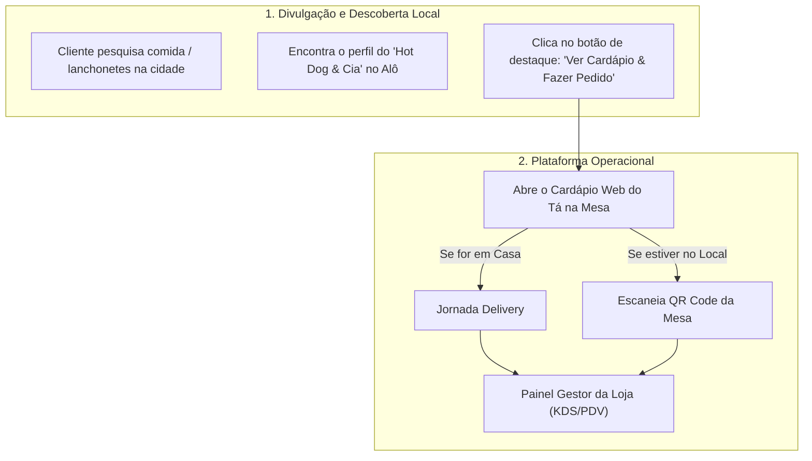

# Engenharia Reversa: InstaDelivery vs. Tá na Mesa

**Documento de Arquitetura e Produto**  
**Data:** 03/11/2026  
**Projeto:** Tá na Mesa (A2i Solutions)  
**Referência Analisada:** InstaDelivery (`instadelivery.com.br`) e caso real **Hot Dog & Cia** (`instadelivery.com.br/hotdogecia`).

---

## 1. Visão Geral da Engenharia Reversa do InstaDelivery

O **InstaDelivery** se consolidou como uma das ferramentas mais populares para alimentação no Brasil (como o Hot Dog & Cia em Natal/RN) porque resolveu três grandes dores do pequeno e médio restaurante:

1. **Fuga das taxas abusivas do iFood** (não cobra comissão percentual sobre os pedidos).
2. **Cardápio Digital Web sem atrito** (o cliente não precisa baixar app da Play Store/App Store; abre direto no navegador do celular via link ou QR Code).
3. **Gestor de Pedidos simples** (um painel web/app tipo "iFood Loja", com som de sino quando chega pedido, impressão em impressora térmica e controle de status).

```mermaid
flowchart LR
    A["Cliente (Web/PWA)"] -->|Link / QR Code| B["Cardápio Digital"]
    B -->|Envia Pedido| C["Servidor Tá na Mesa"]
    C -->|Tempo Real (Som + KDS)| D["Painel Gestor / Loja"]
    C -->|Notificação| E["Garçom / Cozinha"]
    F["Alô Classificados"] -->|Tráfego / Perfil da Loja| B
```

---

## 2. Como Funciona a Experiência do Cliente no InstaDelivery

Analisando a interface e fluxo do **Hot Dog & Cia**:

### 2.1. Jornada de Acesso e UX
* **URL Amigável:** `dominio.com.br/nomedaloja` (ex: `/hotdogecia`).
* **Header Informativo:**
  * Logo e foto de capa do estabelecimento.
  * Status da loja: **Aberto** ou **Fechado**.
  * Tempo médio estimado (ex: 40-60 min).
  * Pedido mínimo (ex: R$ 15,00) e formas de pagamento aceitas (Pix, Cartão, Dinheiro).
  * Botão de contato direto via WhatsApp.
* **Seleção de Modalidade (Logo na entrada):**
  * `🛵 Delivery` (pede endereço e calcula taxa).
  * `🛍️ Retirada no Balcão` (takeaway sem frete).
  * `🍽️ Consumo no Local / Mesa` (solicita ou já identifica o número da mesa via parâmetro `?mesa=XX`).

### 2.2. Navegação e Personalização de Itens
* **Categorias em abas horizontais:** (Ex: "Hot Dogs Tradicionais", "Hambúrgueres Artesanais", "Bebidas", "Combos").
* **Card do Produto:** Foto destacada, título, descrição dos ingredientes e preço base.
* **Modal de Customização:**
  * Escolha de complementos obrigatórios ou opcionais (ex: "Molho extra", "Ponto da carne").
  * Opções de retirada (ex: "Sem cebola", "Sem maionese").
  * Campo aberto de observações.
* **Carrinho Flutuante e Persistente:** O cliente vê o subtotal no rodapé e não perde os itens se atualizar a página (salvo em *LocalStorage*).

### 2.3. Checkout Descomplicado
* O cliente informa apenas:
  1. Nome e Telefone WhatsApp (para rastreio e contato).
  2. Endereço (se delivery) ou Mesa (se salão).
  3. Forma de Pagamento (Direto ao entregador/garçom ou Pix).
* **Confirmação:** O pedido vai para a loja e o cliente recebe a tela de acompanhamento com atualização de status:
  `Pendente` $\rightarrow$ `Aceito / Em Preparo` $\rightarrow$ `Saiu para Entrega / A Caminho da Mesa` $\rightarrow$ `Concluído`.

---

## 3. Como Funciona o Painel do Lojista ("Gestor de Loja / PDV")

Inspirado no painel do iFood Loja, o gestor do InstaDelivery opera da seguinte forma:

```
+-----------------------------------------------------------------------------------+
|  TÁ NA MESA - GESTOR DE LOJA                           Status: [ LOJA ABERTA ]    |
+-----------------------------------------------------------------------------------+
|  [NOVO PEDIDO]   |   [EM PREPARO]    |   [PRONTO / ENTREGA]   |   [FINALIZADOS]   |
|                  |                   |                        |                   |
|  #104 - Mesa 03  |   #102 - Delivery |   #101 - Retirada      |   #099 - Mesa 01  |
|  2x Hot Dog      |   1x Burger Smash |   1x Combo Casal       |   Pago: R$ 45,00  |
|  Total: R$ 38,00 |   Total: R$ 42,00 |   Total: R$ 65,00      |   [Ver Comanda]   |
|  [ACEITAR]       |   [AVANÇAR >>]    |   [CONCLUIR]           |                   |
+-----------------------------------------------------------------------------------+
|  Módulos: [Mesas/Salão] [Cardápio] [Impressão Automática] [Entregadores] [Config]  |
+-----------------------------------------------------------------------------------+
```

1. **Alerta Sonoro Contínuo:** Quando entra um pedido novo, toca um sinal sonoro até que a cozinha/atendente clique em "Aceitar".
2. **Impressão Térmica Automática:** Envia direto para a impressora térmica (58mm ou 80mm) sem diálogo do Windows, via driver local ou rede, dividindo pedidos:
   - Comanda de comida vai para a cozinha.
   - Comanda de bebidas vai para o balcão/bar.
3. **Módulo de Mesas:**
   - Grade visual de mesas (Verde = Livre, Vermelha = Ocupada, Amarela = Aguardando Conta).
   - Ao clicar na mesa, visualiza a comanda acumulada.

---

## 4. Onde o InstaDelivery Falha (e onde o Tá na Mesa vai Ganhar)

O InstaDelivery é excelente em **Delivery**, mas **fraco na experiência presencial de Salão**:

| Critério | InstaDelivery | **Tá na Mesa (Nossa Proposta)** |
| :--- | :--- | :--- |
| **Foco de Origem** | Nasceu para Delivery e adaptou uma função simples de mesa. | **Nativo Híbrido:** desenhado com o mesmo peso para Salão e Delivery. |
| **Sessão Compartilhada na Mesa** | Cada pedido pelo QR code cai como um pedido avulso; não há uma comanda viva contínua da mesa sincronizada. | **Comanda Viva em Tempo Real:** O garçom lança um item no salão; o cliente senta, escaneia o QR Code e **já vê tudo o que foi lançado na mesa**. |
| **Acompanhamento no Salão** | O cliente não sabe quando o garçom está trazendo o prato. | **Notificação de mesa:** A cozinha finaliza e avisa *"Seu pedido está a caminho da sua mesa"*. |
| **Chamar Garçom** | Apenas mensagens estáticas de WhatsApp. | **Botão Direto "Chamar Garçom / Pedir a Conta"** que toca no painel e no app do garçom. |
| **Origem do Tráfego (Aquisição)** | O restaurante precisa se virar para divulgar o link no Instagram/WhatsApp. | **Ecossistema Alô Classificados:** O restaurante ganha vitrine local gratuita no Alô e fecha a operação no Tá na Mesa. |

---

## 5. A Conexão Estratégica: Alô Classificados $\rightarrow$ Tá na Mesa

A grande jogada comercial para o Tá na Mesa é o **funil de atração**:



* **Para o Comerciante:** O Alô Classificados oferece o anúncio e o público local. O Tá na Mesa entrega a máquina de processar pedidos, mesas e comandas sem cobrar comissão.
* **Modelo de Cobrança:** Implantação única (para cadastrar cardápio, configurar mesas e impressora) + Mensalidade fixa acessível.

---

## 6. Arquitetura Funcional Recomendada para o MVP

Para lançarmos uma versão enxuta, estável e moderna (semelhante ao InstaDelivery e iFood Loja):

### Módulo 1: Cardápio Web & PWA (Cliente)
* Funciona 100% no navegador (Chrome, Safari móvel) via URL única (`tanamesa.app/hotdogecia`).
* Modo Delivery: seleção de endereço, taxa de entrega e envio do pedido.
* Modo Mesa/Salão: leitura do QR Code (`tanamesa.app/hotdogecia?mesa=4`), visualização de itens da comanda e botão "Chamar Garçom".

### Módulo 2: Gestor de Pedidos & PDV (Restaurante)
* Painel operacional em tela cheia para computador ou tablet do balcão.
* Colunas de pedidos com alerta sonoro.
* Mapa de Mesas com status em tempo real.
* Botão para "Confirmar Pagamento e Fechar Mesa".

### Módulo 3: App do Garçom / KDS da Cozinha
* Garçom: abre mesas, anota itens na mesa pelo celular e recebe alertas de chamados dos clientes.
* Cozinha (KDS): tela simplificada com os pratos a fazer e botão "Pronto para Servir".
