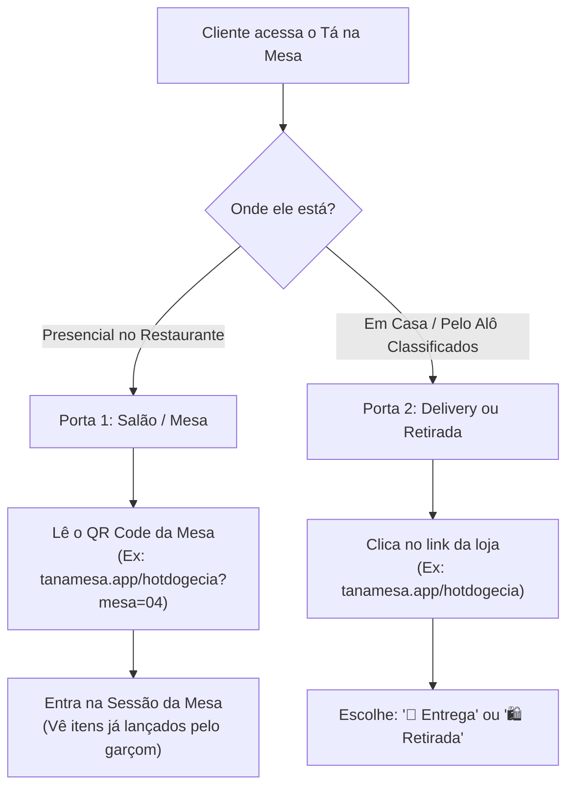

# Especificação: Experiência do Cliente no Tá na Mesa

**Documento de Produto e UX (*User Experience*, ou Experiência do Usuário)**  
**Data:** 03/11/2026  
**Projeto:** Tá na Mesa (A2i Solutions)  
**Módulo:** 1. Cardápio Digital & Jornada do Cliente (Salão e Delivery)

---

## 1. As Duas Portas de Entrada do Cliente

O cliente acessa o Tá na Mesa de duas formas diferentes, mas em uma **única aplicação web**:



---

## 2. Jornada do Cliente no Salão (Mesa e Comanda Viva)

Esta é a grande inovação do Tá na Mesa em relação ao InstaDelivery e outros concorrentes: a mesa não é apenas um formulário de pedido, mas uma **comanda viva e sincronizada**.

### Etapa 1: Leitura do QR Code (*Quick Response Code*, ou Código de Resposta Rápida)
* O cliente aponta a câmera do celular para o QR Code na mesa (ou no tablet do garçom).
* Abre o navegador direto na URL daquela mesa específica (sem precisar baixar aplicativo na loja).

### Etapa 2: Acesso à Comanda da Mesa
* **Se o garçom já abriu a mesa e anotou bebidas:** o cliente já vê esses itens listados na tela com os valores e status (*"2x Coca-Cola Zero - Entregue"*).
* **Se a mesa acabou de ser aberta:** a comanda começa vazia e disponível.
* **Múltiplas pessoas na mesa:** Todos que lerem o QR Code da Mesa 04 têm acesso à mesma comanda em tempo real. Se um amigo pedir uma porção de batata frita, ela aparece na tela dos outros amigos na mesma hora.

### Etapa 3: Fazer Pedidos pela Mesa
* O cliente navega pelas categorias do cardápio.
* Clica em um item (ex: *Hot Dog Especial*), escolhe adicionais (ex: *bacon extra*) ou observações (ex: *sem cebola*).
* Clica em **"Adicionar à Comanda da Mesa"**.
* O pedido é enviado diretamente para a cozinha e para o painel do garçom.

### Etapa 4: Interação com a Equipe
* Na tela da mesa, há botões rápidos de atendimento:
  * 🔔 **Chamar Garçom:** O garçom recebe um aviso sonoro e visual no aplicativo dele: *"Mesa 04 está chamando"*.
  * 🧊 **Pedir Gelo / Copos / Pratos extras:** Solicitações rápidas sem atrito.
  * 🧾 **Pedir a Conta:** Avisa o garçom ou caixa que a mesa deseja encerrar.

### Etapa 5: Acompanhamento em Tempo Real
O cliente vê o status de cada item pedido:
1. 🟡 **Recebido:** A cozinha visualizou o pedido.
2. 🟠 **Em Preparo:** A chapa/cozinha está fazendo o prato.
3. 🟢 **A Caminho da Mesa:** O prato ficou pronto e o garçom está levando até a mesa.
4. ✔️ **Entregue:** Item servido.

### Etapa 6: Conferência da Conta e Pagamento
* O cliente toca em **"Ver Conta"**.
* Visualiza o detalhamento de tudo o que foi consumido na mesa, subtotal, taxa de serviço opcional (se o restaurante ativar) e total geral.
* O cliente clica em **"Confirmar Conferência da Conta"** (ele avisa que está de acordo).
* O garçom ou caixa vai até a mesa com a maquininha do estabelecimento (ou o cliente vai até o caixa físico).
* O restaurante registra o recebimento e clica em **"Dar Baixa e Liberar Mesa"**.
* A tela do cliente atualiza para a tela de agradecimento com pesquisa de satisfação (1 a 5 estrelas + comentário).

---

## 3. Jornada do Cliente no Delivery e Retirada

Para quem está pedindo de casa através do link encontrado no **Alô Classificados**, no Instagram ou no WhatsApp.

### Etapa 1: Identificação e Escolha de Modalidade
* Ao abrir o link `tanamesa.app/hotdogecia`:
* Um aviso destaca o status da loja:
  * 🟢 **Aberto agora** (ex: *Previsão de entrega: 40 a 50 min*).
  * 🔴 **Fechado no momento** (com o horário da próxima abertura).
* O cliente escolhe:
  1. `🛵 Entrega em Domicílio (Delivery)`
  2. `🛍️ Retirada no Balcão`

### Etapa 2: Endereço e Cálculo da Taxa de Entrega
* O cliente informa o endereço ou seleciona o bairro.
* O sistema aplica a regra configurada pelo restaurante:
  * Taxa fixa;
  * Taxa por bairro;
  * Taxa por km de distância;
  * Frete grátis caso atinja o valor mínimo promocional.

### Etapa 3: Montagem do Pedido (Carrinho de Compras)
* O cliente escolhe os lanches, adiciona opcionais e bebidas.
* O carrinho exibe o resumo com foto, quantidade, adicionais e valor total.
* Os itens ficam salvos no celular do cliente: se a internet cair ou ele fechar a página por engano, ao reabrir os itens ainda estarão lá.

### Etapa 4: Checkout Simples (Sem Cadastros Longos)
Para não perder vendas com formulários chatos, o cliente preenche apenas:
1. **Nome:** (Ex: Fábio Barbosa)
2. **WhatsApp:** (Ex: 84 99999-9999) - para receber o link do pedido e avisos.
3. **Endereço Completo:** (com número, complemento e ponto de referência).
4. **Forma de Pagamento:**
   * Pagar na Entrega: Cartão de Crédito, Cartão de Débito ou Dinheiro (com campo de "Precisa de troco para quanto?").
   * Pix Direto: Mostra a chave Pix do restaurante e botão de copiar código.

### Etapa 5: Rastreio do Pedido Delivery
Após clicar em **"Finalizar Pedido"**, a tela vira uma linha do tempo em tempo real:
* 🕒 **Aguardando confirmação do restaurante** (toca no painel do restaurante).
* 👨‍🍳 **Pedido aceito e em preparo**.
* 🛵 **Saiu para entrega** (com nome do entregador, se cadastrado).
* 🎉 **Entregue**.

---

## 4. Anatomia do Cardápio Digital (UI - *User Interface*, ou Interface Visual)

Estrutura pensada para celulares (telas verticais):

```
+-------------------------------------------------------------+
|  [FOTO DE CAPA DO RESTAURANTE]                              |
|  (Logo) HOT DOG & CIA                    🟢 Aberto agora    |
|  ⭐ 4.9 (120 avaliações) • ⏱️ 40-50 min • 📍 Redinha, Natal |
|  ---------------------------------------------------------  |
|  [🛵 Delivery]   [🛍️ Retirada]   [🍽️ Mesa 04]              |
+-------------------------------------------------------------+
|  [Pesquisar produto...]                               🔍    |
|  [🔥 Mais Pedidos] [🌭 Hot Dogs] [🍔 Burgers] [🥤 Bebidas]  |
+-------------------------------------------------------------+
|  🌭 HOT DOGS TRADICIONAIS                                   |
|                                                             |
|  +-------------------------------------------------------+  |
|  | Hot Dog Especial                        [ FOTO DO     |  |
|  | Pão brioche, 2 salsichas, molho caseiro,|   HOT DOG ] |  |
|  | milho, queijo ralado e batata palha.    |             |  |
|  | A partir de R$ 18,00                    [ + ADICIONAR]|  |
|  +-------------------------------------------------------+  |
|                                                             |
|  +-------------------------------------------------------+  |
|  | Smash Burger Salada                     [ FOTO DO     |  |
|  | Pão australiano, 2 carnes de 90g, queijo|   BURGER  ] |  |
|  | cheddar e alface americana.             |             |  |
|  | A partir de R$ 26,00                    [ + ADICIONAR]|  |
|  +-------------------------------------------------------+  |
+-------------------------------------------------------------+
|  🛒 VER COMANDA / CARRINHO (3 itens)           R$ 62,00  >  |
+-------------------------------------------------------------+
```

---

## 5. Diferenciais de Experiência exclusivos do Tá na Mesa

1. **Zero Fricção de Cadastro:** Nenhum cliente precisa criar conta com senha antes de ver o cardápio. Ele só informa o nome e WhatsApp no momento em que for fechar o pedido.
2. **Comanda Transparente:** No salão, acaba aquela dúvida clássica: *"Será que o garçom anotou a nossa cerveja?"*. O cliente olha para o celular e vê exatamente o que está lançado e em que etapa do preparo está.
3. **Respeito ao Comerciante:** O cliente sabe que está comprando diretamente da loja do seu bairro, sem taxas inflacionadas pelo aplicativo.


---

## 6. Divisão de Conta Inteligente (Salão / Mesa)

A divisão de conta é uma das maiores dores em bares e restaurantes. No Tá na Mesa, ela funciona de forma híbrida: tanto pelo celular do cliente quanto pela tela do garçom/caixa.

`mermaid
flowchart TD
    A["Mesa solicita fechamento da conta"] --> B{"Como será a divisão?"}
    
    B -->|Divisão Igual| C["Informa número de pessoas (Ex: 3)"]
    C --> D["Sistema divide: R$ 90 / 3 = R$ 30,00 por pessoa"]
    D --> E["Garçom passa a maquininha 3x de R$ 30,00"]
    
    B -->|Divisão por Valor Diferente| F["Informa valor avulso da 1ª pessoa"]
    F --> G["Registra pagamento parcial de R$ 40,00"]
    G --> H["Saldo restante abate na hora (R$ 90 - R$ 40 = R$ 50)"]
    H --> I["Cobra as pessoas seguintes até o saldo zerar"]
    
    E --> J["Mesa Quitada: Baixa automática e notificação nos celulares"]
    I --> J
`

### 6.1. Modo A: Divisão Igualitária (Racha Igual)
1. O garçom seleciona: **"Dividir Conta"** $\rightarrow$ Pergunta: *"Quantas pessoas?"* (Ex: 4 pessoas).
2. Pergunta: *"Valores iguais?"* $\rightarrow$ **SIM**.
3. O sistema calcula na hora a cota de cada um (ex: Total R$ 120,00 $\rightarrow$ 4 cotas de R$ 30,00).
4. O garçom passa a maquininha para a 1ª pessoa e clica em **"Baixa Parcial 1/4 (R$ 30,00)"**.
5. Na tela dos clientes e no painel do garçom, uma barra de progresso visual atualiza em tempo real:
   * [███░░░░░░░] 25% Pago - Restante: R$ 90,00
6. Cada pessoa vai pagando até que a última cota seja quitada.

### 6.2. Modo B: Divisão Flexível (Valores Diferentes)
1. Pergunta: *"Valores iguais?"* $\rightarrow$ **NÃO**.
2. O sistema abre o campo de abatimento progressivo:
   * **Pessoa 1:** Paga R$ 50,00 no cartão de débito. O garçom registra $\rightarrow$ Saldo cai para R$ 70,00.
   * **Pessoa 2:** Paga R$ 40,00 no Pix. O garçom registra $\rightarrow$ Saldo cai para R$ 30,00.
   * **Pessoa 3:** Paga os R$ 30,00 restantes em dinheiro.
3. Ao atingir R$ 0,00 de saldo restante, o sistema confirma o fechamento total da comanda.
4. **Notificação em tempo real:** Quem estiver com o cardápio aberto no celular vê a mensagem de encerramento: *"Conta encerrada com sucesso! Obrigado pela preferência."* e abre a tela de avaliação.

---

## 7. Delivery: Cupons Estratégicos & Taxas Condicionais (Integração Alô Classificados)

No InstaDelivery convencional, o cálculo de frete por raio é rígido e cobra de todo mundo. No Tá na Mesa, criamos uma ponte direta com as parcerias locais do **Alô Classificados**.

### 7.1. Link Patrocinado com Cupom Embutido (Deep Link)
* Quando o cliente clica no anúncio do Hot Dog & Cia dentro do **Alô Classificados**, o link já chega no Tá na Mesa com os parâmetros de benefício:
  	anamesa.app/hotdogecia?origem=aloclassificados&cupom=FRETEALO
* **Aplicação Automática:** O cliente não precisa digitar nada. Ao entrar no cardápio, uma barra verde avisa no topo:
  🎉 *Benefício Alô Classificados ativado: Frete Grátis para seu bairro!*

### 7.2. Regras Condicionais de Frete para o Comerciante
No painel do restaurante, o lojista tem total liberdade para configurar regras inteligentes:
1. **Isenção por Bairro / Região:** (Ex: "Bairro Redinha tem taxa R$ 0,00 para pedidos acima de R$ 30,00").
2. **Cupons de Parceria Alô Classificados:**
   * Cupom de Frete Grátis condicional (apenas para bairros vizinhos).
   * Cupom de Desconto em Reais (ex: R$ 5,00 OFF) ou em Porcentagem (ex: 10% OFF no primeiro pedido).
3. **Trava de Segurança:** O cupom só zera a taxa se a entrega for dentro da área combinada da promoção, evitando prejuízo ao restaurante caso alguém peça de muito longe.


### 7.3. Campanhas de Ativação Regional (Campanha "Frete Grátis no seu Bairro")
Além do link automático, o sistema tem o campo clássico de **Inserir Cupom** no checkout para campanhas promocionais locais divulgadas no Instagram, WhatsApp ou panfletos:
* **Ação do Estabelecimento / Alô Classificados:** Lança uma campanha dizendo:  
  *"Moradores da Redinha: peçam no Hot Dog & Cia e usem o cupom REDINHAGRATIS para não pagar taxa de entrega!"*
* **Validação Inteligente no Carrinho:**
  1. O cliente escolhe os lanches e digita o cupom REDINHAGRATIS.
  2. O sistema confere se o endereço/bairro selecionado pertence à área permitida da campanha.
  3. Se pertencer: a taxa de entrega é zerada na hora (*De R$ 8,00 por R$ 0,00*).
  4. Se o cliente for de outro bairro distante: o sistema avisa com respeito: *"Este cupom é exclusivo para entregas no bairro Redinha"*.
* **Benefício:** Estimula o comércio de bairro, atrai os clientes da vizinhança e protege o restaurante contra cobranças indevidas de frete em distâncias longas.


---

## 8. Múltiplas Comandas na Mesma Mesa Física (Subcomandas Individuais)

Uma das maiores frustrações em bares e espetinhos ocorre quando amigos ou casais sentam na mesma mesa, mas querem contas totalmente separadas desde o primeiro momento. Na maioria dos sistemas legados de PDV (*Ponto de Venda*, ou Frente de Caixa), o sistema amarra uma mesa a apenas uma comanda, forçando o garçom a criar "mesas fantasmas" ou gerando constrangimento na hora de pagar.

No Tá na Mesa, uma **única mesa física pode conter múltiplas comandas independentes**.

`
MESA FÍSICA 04 (Espetinho & Bar)
 ├── Comanda 01: Fábio & Esposa (R$ 68,00) -> QR Code Pessoal no celular
 └── Comanda 02: Cunhada & Esposo (R$ 44,00) -> QR Code Pessoal no celular
`

### 8.1. Como Funciona a Abertura na Chegada
1. O grupo senta na Mesa 04.
2. O garçom pergunta: *"A comanda será única para a mesa ou vocês querem comandas individuais/por casal?"*.
3. Se quiserem comandas separadas:
   * **Pelo Celular do Cliente:** Ao escanear o QR Code (*Código de Resposta Rápida*) da Mesa 04, o sistema detecta a mesa e pergunta:  
     *[+] Entrar na comanda existente* ou *[+] Abrir nova comanda nesta mesa*.
   * O cliente digita seu nome (ex: *"Cunhada"*).
   * O sistema gera um **QR Code Pessoal de Identificação** na tela do celular daquele cliente.

### 8.2. Como o Garçom Lança os Pedidos sem Confusão
Quando o garçom vem atender a mesa:
* **Método 1 (Pelo Nome no App do Garçom):** O garçom seleciona a Mesa 04 e vê os cartões separados: [ Comanda Fábio ] e [ Comanda Cunhada ]. Ele toca no nome de quem está pedindo e lança a cerveja ou o espetinho.
* **Método 2 (Bip Rápido na Maquininha/Celular do Garçom):** O cliente mostra o QR Code no seu próprio celular. O garçom apenas aponta a câmera da maquininha/celular, bipa o QR do cliente e o sistema já abre a comanda certa instantaneamente.
* **Método 3 (Autoatendimento):** Se o cliente pedir direto pelo próprio celular, o item cai direto na sua respectiva comanda da mesa.

### 8.3. Fechamento e Saída Independente (O Pulo do Gato)
* **Saída em Horários Diferentes:** Se a cunhada e o esposo precisarem ir embora mais cedo, eles não precisam esperar o resto da mesa terminar.
* O garçom fecha **apenas a Comanda 02**, passa a maquininha no valor de R$ 44,00 e dá baixa.
* A Comanda 02 é encerrada, mas a **Mesa 04 continua 🔴 Ocupada e ativa** com a Comanda 01 do Fábio consumindo normalmente até o final da noite.


---

## 9. Vinculação Dinâmica: Conectando o Celular a uma Comanda Já Aberta

Este é o cenário perfeito em que o cliente começou sendo atendido de forma 100% tradicional e, no meio da noite, resolveu usar o celular.

`mermaid
flowchart TD
    A["Cliente lê o QR Code da mesa no display"] --> B["Sistema detecta: Mesa 04 tem 2 comandas ativas"]
    B --> C["Tela lista: [Fábio] e [Cunhada]"]
    C --> D{"Quem está acessando?"}
    D -->|Toca em 'Fábio'| E["Vincula o celular à Comanda 01"]
    E --> F["Comanda 01 fica com selo: 'Conectado'"]
    D -->|Cunhada acessa depois| G["Sistema mostra apenas 'Cunhada' disponível"]
    G --> H["Cunhada toca e vincula seu celular"]
`

### 9.1. O Fluxo de Autoatribuição (Super Amigável)
1. **O Convite Físico:** Na mesa há um display de acrílico ou adesivo com a marca Tá na Mesa:  
   *"Acompanhe seu pedido em tempo real! Aponte a câmera do seu celular para este QR Code"*.
2. **A Leitura:** O cliente (Fábio) aponta a câmera.
3. **A Autenticação Rápida:** O cliente entra na sua conta (com login rápido por WhatsApp ou Google, igual ao padrão utilizado no Alô Classificados).
4. **O Reconhecimento da Mesa:** O sistema identifica:  
   *"Você está na Mesa 04. Identificamos as seguintes comandas abertas pelo garçom:"*
   * 👤 **Comanda 01: Fábio** (2 itens lançados, R$ 45,00) $\rightarrow$ [ Sou eu ]
   * 👤 **Comanda 02: Cunhada** (1 item lançado, R$ 22,00) $\rightarrow$ [ Sou eu ]
   * ➕ **Abrir uma nova comanda para mim nesta mesa**
5. **A Conexão:** Ao clicar em **"Sou eu: Fábio"**, a Comanda 01 é vinculada ao celular do Fábio.
6. **Proteção para a Cunhada:** 
   * Quando a cunhada for escanear o QR Code minutos depois, a comanda do Fábio já aparece com o selinho verde de *"Vinculada"*.
   * O sistema exibe para ela apenas:  
     *"Identificamos a sua comanda: **Cunhada**. Deseja conectar?"*.
   * Ela clica e assume a dela com um único toque!

### 9.2. A Alternativa com Auxílio do Garçom (Atalho Rápido na Maquininha)
Se o cliente preferir pedir ajuda ao garçom (*"Garçom, baixei o aplicativo, como vejo meus pedidos?"*):
1. O garçom abre a Mesa 04 no aplicativo do garçom / Smart POS (*Maquininha de Cartão Inteligente* com tela touch).
2. Toca na comanda do Fábio e clica em **[Gerar QR Code de Conexão]**.
3. A maquininha exibe um QR Code na tela.
4. O Fábio apenas aponta a câmera do celular para a tela da maquininha do garçom e conecta instantaneamente à sua comanda.
