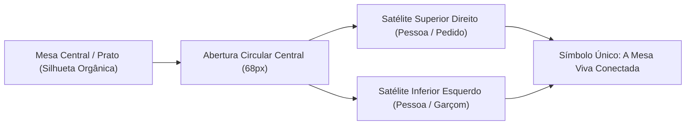

# Manual de Identidade Visual & Branding: Tá na Mesa (v1.1 Oficial)

> **Solução Desenvolvida e Mantida por:** **A2i Solutions** (Liderança de Produto: Fábio Barbosa)  
> **Parceiro Comercial & Estratégico:** **Alô Classificados**  
> **Versão da Marca:** Kit de Identidade Visual 1.1 Oficial  
> **Descritor de Categoria:** `Restaurantes e Delivery`  

---

## 1. O Símbolo Aprovado (Geometria & Significado)

Após pesquisa e definição pelo responsável de produto Fábio Barbosa, o símbolo oficial do **Tá na Mesa** representa a **convergência entre a mesa de refeição e o convívio das pessoas**:



### 1.1. Grid & Proporções Construtivas
- **Grid do Ícone do Aplicativo:** Caixa quadrada de **76 × 76 unidades**, com raio de canto (`rx`) de **14,44 unidades**.
- **Proporção do Vetor:** O símbolo ocupa **62 × 62 unidades**, perfeitamente centralizado com **7 unidades de respiro** em cada margem lateral.
- **Formato Vetorial Nativo:** SVG 256 × 256 com traçado contínuo `fill-rule="evenodd"` e esferas focais de raio `r=20`.

```xml
<svg viewBox="0 0 256 256" xmlns="http://www.w3.org/2000/svg">
  <path fill="#BD4D2D" fill-rule="evenodd" d="M39 56 Q47 48 67 44 L186 22 Q202 18 207 29 Q211 37 203 49 Q195 63 200 76 Q203 83 214 85 Q232 87 237 105 Q239 111 237 120 L216 207 Q212 229 193 231 L81 231 Q61 230 58 211 L54 189 Q52 176 45 167 L30 148 Q22 137 20 123 L15 106 Q10 85 23 69 Q29 61 39 56 Z M195 132 A68 68 0 1 0 59 132 A68 68 0 1 0 195 132 Z"/>
  <circle cx="221" cy="48" r="20" fill="#BD4D2D"/>
  <circle cx="33" cy="207" r="20" fill="#BD4D2D"/>
</svg>
```

---

## 2. Paleta Cromática Oficial de Trabalho

A paleta de cores transmite acolhimento gastronômico, sofisticação e legibilidade imediata em dispositivos móveis e telas de alta intensidade de luz (como salão e chapa de cozinha):

| Amostra | Nome da Cor | Código HEX | Finalidade Principal |
| :---: | :--- | :---: | :--- |
| 🔴 | **Terracota Oficial** | `#BD4D2D` | Cor primária da marca, botões de ação e ícone do cliente. |
| ⚫ | **Carvão Profundo** | `#231F1C` | Tipografia de alto contraste, fundos escuros e cabeçalhos. |
| 🍦 | **Creme Acolhedor** | `#FBF6EF` | Cor de fundo institucional de todas as telas (replaces antigo `#FDFBF7`). |
| 📄 | **Papel Limpo** | `#FFFDFA` | Superfície de cartões, modais e recipientes de dados. |
| 🟤 | **Garçom (Salão)** | `#694838` | Tom terroso refinado para identificação do terminal do garçom. |
| 🔘 | **Gestão (PDV)** | `#302E2D` | Grafite técnico para o backoffice administrativo e PDV. |
| ⚪ | **Branco Puro** | `#FFFFFF` | Contraste interno dos símbolos e textos sobre fundos densos. |

---

## 3. Tipografia & Arquitetura de Nomenclatura

- **Logotipo Principal:**  
  `Tá na Mesa`  
  - Família tipográfica: Arial / Helvetica / Inter (sans-serif geométrica limpa).  
  - Peso: **800 (ExtraBold)**.  
  - Tracking (Letter-spacing): **-2px** (aproximação óptica para coesão).  
  - Destaque: `Tá na` em Carvão (`#231F1C`) + `Mesa` em Terracota (`#BD4D2D`).
- **Descritor de Marca:**  
  `RESTAURANTES E DELIVERY`  
  - Caixa: Maiúsculas (All-caps).  
  - Peso: **700 (Bold)**.  
  - Tracking (Letter-spacing): **+2px** (espaçamento elegante de assinatura).  
  - Cor: Terracota (`#BD4D2D`) ou Branco sobre fundo escuro.

---

## 4. Família de Arquivos Vetoriais do Kit (SVG & PNG)

Todos os ativos foram incorporados à estrutura do projeto em `public/brand/`:

```
public/brand/
├── svg/
│   ├── assinatura-horizontal.svg              (Horizontal com descritor)
│   ├── assinatura-horizontal-sem-descritor.svg (Horizontal compacta)
│   ├── assinatura-horizontal-branca.svg       (Versão negativa sobre fundo escuro)
│   ├── assinatura-vertical.svg                (Vertical com descritor)
│   ├── assinatura-vertical-sem-descritor.svg  (Vertical sem descritor)
│   ├── assinatura-vertical-branca.svg         (Vertical negativa)
│   ├── icone-app-cliente.svg                  (App Cliente Terracota #BD4D2D)
│   ├── icone-app-garcom.svg                   (App Garçom Terra #694838)
│   ├── icone-app-gestao.svg                   (App Gestão Grafite #302E2D)
│   ├── simbolo-terracota.svg                  (Vetor isolado #BD4D2D)
│   ├── simbolo-carvao.svg                     (Vetor isolado #231F1C)
│   ├── simbolo-branco.svg                     (Vetor isolado #FFFFFF)
│   ├── avatar-redes.svg                       (Foto de perfil 1080x1080)
│   ├── capa-apresentacao.svg                  (Slide mestre 1920x1080)
│   ├── papel-timbrado.svg                     (A4 institucional timbrado)
│   └── marca-dagua.svg                        (Marca d'água 10% opacidade)
├── png/                                       (Exportações rasterizadas em alta resolução)
└── Guia_Identidade_Ta_na_Mesa.html            (Guia interativo com pranchas de uso)
```

---

## 5. Implementação no Código-Fonte do Tá na Mesa

| Componente / Arquivo | Atualização Realizada |
| :--- | :--- |
| `components/Logo.tsx` | Reconstruído para desenhar o vetor nativo exato, suportando `size`, `variant`, `role` (`cliente`, `garcom`, `gestao`) e descritor oficial. |
| `app/globals.css` | Atualização das variáveis CSS raiz (`--background: #FBF6EF;`, `--foreground: #231F1C;`, `--terracota: #BD4D2D;`). |
| `app/layout.tsx` | Atualização do `themeColor: "#BD4D2D"` e descritivo oficial de metadados: *"Tá na Mesa \| Restaurantes e Delivery • A2i Solutions"*. |
| `public/manifest.json` | Configuração PWA com ícone de aplicativo cliente e cores oficiais. |
| `public/icon.svg` | Substituído pelo novo ícone vetorial terracota para aba de navegação e atalhos. |
