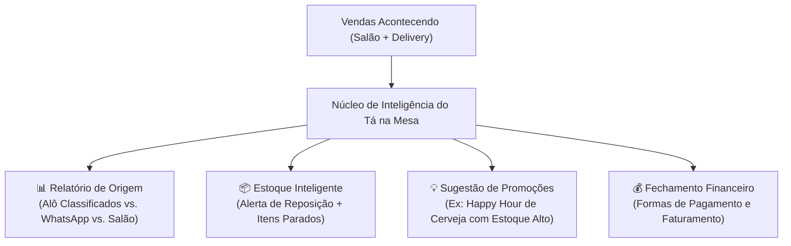

# Especificação: Relatórios Administrativos & Estoque Inteligente

**Documento de Gestão de Negócios e BI (*Business Intelligence*, ou Inteligência de Negócios)**  
**Data:** 03/11/2026  
**Projeto:** Tá na Mesa (A2i Solutions)  
**Módulo:** 5. Gestão Administrativa, Controle de Estoque e Análise de Vendas

---

## 1. Visão Geral

O comerciante local não precisa apenas de um anotador de pedidos; ele precisa de um **painel de controle do seu negócio**. O módulo de relatórios e estoque do Tá na Mesa transforma os dados da operação em decisões práticas de compra, redução de perdas e aumento de faturamento.

---

## 2. Controle de Estoque com Inteligência Ativa

Em vez de uma planilha fria e burocrática, o estoque atua como um assistente proativo do dono do restaurante:

### 2.1. Alerta de Reposição (O que precisa comprar)
* O sistema monitora o consumo a cada comanda fechada.
* **Nível Crítico:** Quando o estoque de pão brioche, queijo ou carne atinge o nível mínimo configurado, um alerta vermelho surge no painel:  
  ⚠️ *"Atenção: Restam apenas 8 pães brioche. Risco de esgotar hoje antes das 22h"*.
* **Sugestão de Lista de Compras:** Com 1 clique, o sistema gera a listinha de compras no WhatsApp para o fornecedor.

### 2.2. Oportunidade de Campanha (Estoque Alto / Itens Parados)
* O sistema identifica mercadorias com grande volume que estão saindo devagar.
* **Gatilho de Promoção:** Exemplo:  
  💡 *"Você possui 48 garrafas de Cerveja Original no estoque com saída 30% menor nesta semana. Deseja criar uma campanha de Happy Hour (de R$ 14,00 por R$ 10,90 das 18h às 20h) para divulgar no Alô Classificados?"*.
* Isso evita que mercadorias vençam e faz o dinheiro do comerciante girar rápido.

---

## 3. Relatório de Atribuição e Origem das Vendas

Uma das maiores dúvidas do comerciante é: *"De onde estão vindo os meus clientes?"*. O Tá na Mesa separa com precisão matemática:

1. **Vendas via Alô Classificados:**
   * Registra todos os pedidos gerados a partir do link ou cupom promocional do Alô.
   * **Prova de Valor:** Mostra exatamente quanto dinheiro o comerciante faturou graças à divulgação no Alô Classificados (ex: *"Este mês o Alô gerou R$ 4.280,00 em 115 pedidos para sua loja"*).
2. **Vendas via WhatsApp / Redes Sociais:**
   * Pedidos originados de links divulgados no Instagram ou WhatsApp do próprio restaurante.
3. **Vendas no Salão (Mesas Físicas):**
   * Total consumido nas mesas presenciais e tickets médios por cliente.

---

## 4. Métricas Financeiras & Curva ABC de Produtos

* **Faturamento Bruto por Período:** Dia, Semana e Mês.
* **Curva ABC (*Classificação de Produtos por Faturamento*):**
  * **Produtos Classe A (Os Campeões):** Os 20% de itens que representam 80% do lucro da casa (ex: Hot Dog Especial e Cerveja Original).
  * **Produtos Classe C (Os Esquecidos):** Itens com baixa saída que talvez devam ser retirados do cardápio para reduzir custos.
* **Formas de Pagamento Recebidas:**
  * Pix Direto: R$ 3.450,00 (45%)
  * Cartão de Crédito Maquininha: R$ 2.800,00 (37%)
  * Cartão de Débito: R$ 1.100,00 (14%)
  * Dinheiro em Espécie: R$ 320,00 (4%)
